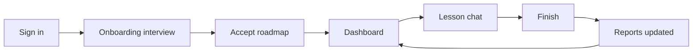

# Lingua Coach

A personal language coach in the browser. You state a real outcome (a job interview in Spanish, travel English in six months). The coach interviews you, writes a course roadmap, and then runs one lesson at a time in text chat: it corrects your answers, logs recurring mistakes, and keeps you on a 24-hour pace per lesson.

The coach does not rely on chat history. After each important moment it stores structured notes (profile, roadmap, lesson curriculum, session summary, mistakes, reports), and the next lesson is built from those. Accepting a plan or finishing a lesson deletes that transcript. Pedagogy lives in [`apps/backend/skills/`](./apps/backend/skills/README.md); the model is Gemini.



## Run it

```bash
cp apps/backend/.env.example apps/backend/.env          # add Clerk keys and GEMINI_API_KEY
cp apps/frontend/.env.example apps/frontend/.env.local  # add Clerk keys
docker compose up                                       # add --profile monitoring for Grafana
```

Open http://localhost:3000. More options are in [`apps/README.md`](./apps/README.md).

## Layout

```
apps/frontend/        Next.js app: sign-in, onboarding, dashboard, lesson chat, reports
apps/backend/         FastAPI API, Postgres models, Alembic, Gemini integration
apps/backend/skills/  Coach pedagogy as markdown, loaded at runtime
infra/monitoring/     Prometheus, Loki, Promtail, Grafana provisioning
docs/mvp/init/        Business and technical requirements
docker-compose.yml    Local stack
```

## Docs

- [Business requirements](./docs/mvp/init/business_requirements/cjm.md): the learner journey, plan days, pacing, and reports.
- [Technical requirements](./docs/mvp/init/tech_requirements/README.md): backend, frontend, AI, database, deployment, and hosting.
- [Skills](./apps/backend/skills/README.md): what each coach skill does.
