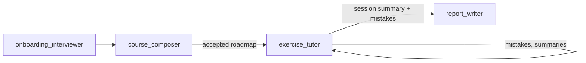

# Lingua Coach — Agent Skills

Goal-agnostic coach skills. The backend loads these files at runtime as the Gemini system instruction; they define **what the coach does**. How the backend wires them (contracts, context, persistence) is in [ai-api.md](../../../docs/tech_requirements/ai-api.md).

| Skill | Loaded for | Role |
|-------|------------|------|
| [onboarding_interviewer.md](./onboarding_interviewer.md) | Onboarding chat | Discovery interview → learner profile |
| [course_composer.md](./course_composer.md) | Onboarding chat | Profile → roadmap, lesson length and rhythm, plan days |
| [exercise_tutor.md](./exercise_tutor.md) | Lesson chat, lesson generation | Curriculum, timed in-chat coaching, praise and error capture |
| [report_writer.md](./report_writer.md) | Lesson finish | Incremental updates to the Progress and Error Log reports |

## Pipeline

## What the coach does

1. **Interacts** with the learner in chat (onboarding and lessons).
2. **Plans** the program (`course_composer` → accepted roadmap).
3. **Conducts** lessons (`exercise_tutor`).
4. **Tracks** mistakes and session outcomes, which the backend stores in Postgres.
5. **Reports** progress and errors after each lesson (`report_writer`).

## Onboarding interview flow

| # | Cluster | Coach language |
|---|---------|----------------|
| 0 | Languages (native, then learning) | English |
| 1 | Goal & outcome | Learning language |
| 2 | Current level | Learning language |
| 3 | Time budget and pace | Learning language |
| 4 | Focus areas and topics | Learning language |
| 5 | Constraints and resources | Learning language |
| 6 | Motivation and context | Learning language |
| — | Summarize → `course_composer` | Learning language |

Learner answers are accepted in any language throughout so beginners can finish. Lessons after accept are full immersion in the learning language.

## Design principles

- **Goal-first, not curriculum-first** — the learner's outcome drives structure.
- **Language of coaching** — start onboarding in English to collect native then learning language; then coach in the learning language. Native is L1-interference context only.
- **Adapt but never lower the goal** — pace adjusts; target outcome does not.
- **Output-first** — write before (or alongside) rule explanation.
- **Structured learner memory** — profile, errors, and progress are data, not chat history.
- **Text chat** — learner–tutor interaction is typed. Product skills are reading and writing. There is no speaking practice.
- **Fixed time budget, personalized content** — every lesson lasts the learner's chosen minutes; what fills them adapts to performance.
- **Skills say how to teach and decide** — payload shapes live in the Pydantic schemas (their field descriptions reach the model), persistence in the routers, context lists in `prompt_assembly.py`.

## Related docs

| Doc | Role |
|-----|------|
| [cjm.md](../../../docs/business_requirements/cjm.md) | Learner journey |
| [ai-api.md](../../../docs/tech_requirements/ai-api.md) | Skill loading, contracts, context per call |
| [database.md](../../../docs/tech_requirements/database.md) | What each artifact persists to |
| [backend.md](../../../docs/tech_requirements/backend.md) | Request flows and lesson lifecycle |
