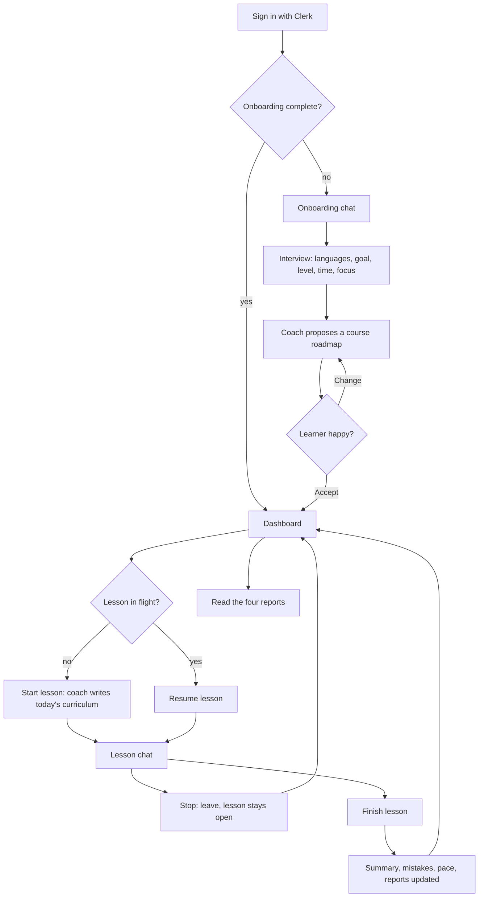

# Customer journey

Lingua Coach is a text-chat language coach. A learner signs in, talks through an onboarding interview, accepts a course roadmap, and then works through it one lesson at a time in chat. Every learner-facing behavior of the coach comes from the skill files in [`apps/backend/skills/`](../../../../apps/backend/skills/README.md).

## Who the learner is

An adult studying a foreign language toward a concrete outcome (for example "run meetings in Spanish within six months"). They have a native language, a target language, a rough self-assessed level, and a limited amount of time per day. They want a coach that remembers what they got wrong and paces the work for them.

## The whole journey

## 1. Sign in

The entry point is the Clerk sign-in page at `/sign-in`. There is no marketing page. After sign-in the app syncs the learner into its own database and routes them:

- to `/onboarding` while no plan has been accepted;
- to `/dashboard` once a plan has been accepted.

## 2. Onboarding interview

The onboarding chat runs the `onboarding_interviewer` skill followed by `course_composer`. The coach asks one question per reply.

1. It starts in English and asks for the native language, then the target language.
2. From then on it speaks the target language and accepts answers in any language.
3. It asks about the goal and horizon, the current level (with a short diagnostic), the time budget per session and per week, skill and topic priorities, constraints (budget, practice partner, learning style), and motivation.
4. When it has enough, it stores a learner profile and proposes a **course roadmap**: goal summary, starting level, target plan days with a range, milestones with success criteria, a weekly session template, and the first block of daily themes.

The roadmap appears next to the chat as a card with **Accept** and **Change**.

- **Change** keeps the card visible and sends a hidden request to the coach, which asks what to adjust. The learner answers in plain words ("fewer days", "more email writing"), and the coach replies with a revised roadmap that replaces the card.
- **Accept** saves the roadmap as the learner's plan, creates the Roadmap and 4-Week Plan reports, deletes the onboarding transcript, and opens the dashboard.

## 3. Dashboard

The dashboard is the home screen after onboarding. It shows:

- the main action, which is **Start lesson** when nothing is in flight and **Resume lesson N** when a lesson is open;
- an elapsed-time counter while a new lesson is being generated, with **Check again** if it runs long and **Try again** if it fails;
- a pace strip with plan days done out of the target, the pace state (on pace, behind, or ahead), and the projected completion date;
- a one-line acknowledgment after a lesson was just finished (for example that it was on pace or that the plan moved by a day).

The account menu in the header opens the four reports and signs out.

## 4. Lessons

### Plan days and pacing

- One **plan day** is one finished lesson. Lessons are numbered 1, 2, 3, … and have no calendar date.
- The roadmap sets a **target** number of plan days. The dashboard shows how many are done.
- **On pace** means the lesson was finished within **24 hours** of when it started. The clock starts when the generated lesson becomes active.
- A lesson can stay open across days. Leaving the chat does not stop the clock.
- Finishing **after** 24 hours marks the lesson as slipped. The plan moves one plan day later and the projected completion date shifts. The learner is never blocked from continuing.
- The pace strip says **behind** when the open lesson is past its 24 hours or the last lesson slipped, **ahead** when the last lesson took at most 12 hours and the plan never slipped, and **on pace** otherwise.

### Start

**Start lesson** is available only when no other lesson is generating or open. The coach writes the curriculum for the next lesson from the accepted roadmap, the learner profile, the last five lesson summaries, and the recorded mistakes. A curriculum holds one lesson goal, one grammar focus, one vocabulary theme, a list of slots (warm-up, input, production, and so on), a reading input task, a goal-specific writing task, and exit criteria. Generation takes up to about two minutes. If it fails, that lesson is marked failed and the learner can start a new one.

### Lesson chat

The lesson chat runs the `exercise_tutor` skill. On week-end vocabulary review lessons it also loads `vocabulary_practice_formats`.

- A collapsible **focus card** at the top shows the lesson goal, grammar focus, and vocabulary theme. It collapses once the conversation starts.
- On the first turn the coach states the agenda. A pinned **checklist** shows the agenda items and ticks them off as the coach marks them done.
- The coach runs each exercise, corrects mistakes inline, gives tips, and reviews weak patterns that are due.
- Recurring errors are saved as **mistake patterns**. A repeated pattern is scheduled for review after 1, 3, 7, and then 14 days, and due patterns are fed back into later lessons.
- The learner can ask for plan changes in the lesson chat ("make it 60 days", "focus on travel"). The coach applies them to the profile and, for the target plan days, recomputes the projected completion date. There is no separate plan editor.
- When every slot and exit criterion is done, the coach suggests finishing.

### Stop and resume

**Stop** returns to the dashboard. The lesson stays open, the transcript is kept, and the 24-hour clock keeps running. **Resume** reopens the same chat with its history.

### Finish

**Finish lesson** is always available while the lesson is open, even before the coach suggests it. It opens a short dialog with an optional free-text note. On finish:

1. The lesson gets a **session summary**: duration, completed and deferred slots, whether the exit criteria were met, the grammar focus, the new mistake patterns, and the learner's note. Unfinished slots count as not done.
2. Pace is evaluated against the 24-hour window, and the plan slips by one day if needed.
3. The Progress and Error Log reports are updated by the `report_writer` skill.
4. The lesson transcript is deleted. The summary, mistakes, and reports are what later lessons read.
5. The learner returns to the dashboard and can start the next lesson.

## 5. Reports

Four markdown reports live under the account menu. They are written by the coach and are read-only for the learner.

| Report | Created | Contents |
|--------|---------|----------|
| Roadmap | On plan accept | Overview, milestones, learning principles, scope notes |
| 4-Week Plan | On plan accept | Block overview, day-by-day themes, weekly session template |
| Progress | After the first finished lesson | Latest session, a skills table (grammar, vocabulary, listening, reading, writing, goal-specific), and an update log |
| Error Log | After the first finished lesson | Pattern tracker, a daily log of fixes, and a list of confusable words |

After each finished lesson the coach appends dated entries or rewrites whole sections. A report that does not exist yet shows "Fills in after your first lesson".

## What the product does

- Text chat only. The learner types, and the coach streams text back.
- One lesson in flight at a time.
- Plan changes happen in chat.
- Transcripts are temporary. The onboarding transcript is deleted on accept and a lesson transcript on finish.
- Usage is capped: 60 chat messages per hour and 2 lesson starts per 24 hours per learner, plus global Gemini limits. When a cap is hit the app shows a "try again later" message.

## What the product leaves out

- Voice input, speech output, video, and speaking practice. Lessons train reading and writing.
- A settings screen or plan editor.
- Calendar scheduling and reminders.
- Ratings, thumbs, or other feedback widgets.
- Abandoning a lesson. An open lesson is finished to move on.

## Terms

| Term | Meaning |
|------|---------|
| Learner profile | Languages, goal, level, time budget, focus, constraints, and motivation from the interview |
| Course roadmap | The proposed plan: summary, milestones, weekly template, first block of themes |
| Plan day | One finished lesson |
| Target plan days | Length of the accepted plan in plan days |
| Pace window | 24 hours from lesson start to finish |
| Slip | A lesson finished after the pace window, which moves the plan one day later |
| Curriculum | The generated content of one lesson |
| Session summary | What was done in a finished lesson |
| Mistake pattern | A named recurring error with an example and a review date |
