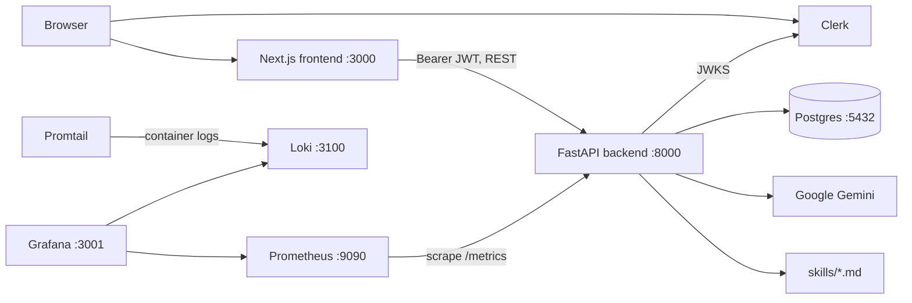

# Technical requirements

How Lingua Coach is built. The learner-facing behavior is in [business_requirements/cjm.md](../business_requirements/cjm.md).

| Doc | Covers |
|-----|--------|
| [backend.md](./backend.md) | FastAPI service, endpoints, request flows, limits, errors |
| [frontend.md](./frontend.md) | Next.js routes, screens, API clients |
| [ai-api.md](./ai-api.md) | Gemini calls, skill loading, prompt context |
| [database.md](./database.md) | Postgres tables, JSON shapes, lifecycles |
| [deployment.md](./deployment.md) | Docker Compose, environment variables, migrations, CI |
| [hosting.md](./hosting.md) | Where each piece runs and what is external |
| [refinement-plan.md](./refinement-plan.md) | Code review findings, RAG, LangSmith evals, test framework, refinement PRs (backend implemented) |

## System overview

| Layer | Technology |
|-------|------------|
| Frontend | Next.js 16 (App Router), React 19, Tailwind CSS 4, `@clerk/nextjs` |
| Backend | Python 3.11, FastAPI, async SQLAlchemy 2, Alembic, `uv` |
| Database | PostgreSQL 16 |
| LLM | Gemini through `langchain-google-genai` |
| Auth | Clerk (frontend sessions, backend JWT verification) |
| Monitoring | Prometheus, Loki, Promtail, Grafana (Compose profile `monitoring`) |
