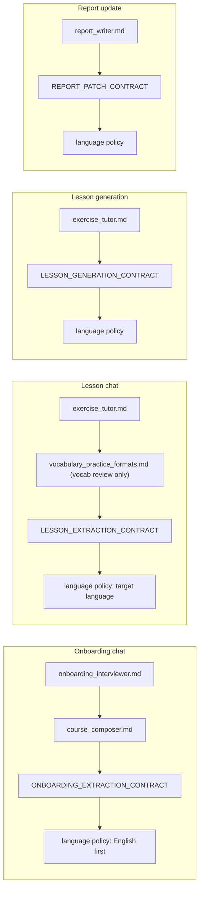

# AI integration

The coach is Google Gemini called through LangChain (`langchain-google-genai`). Its behavior is the markdown in [`apps/backend/skills/`](../../../../apps/backend/skills/README.md); the backend adds short output contracts, a language policy, and per-call context.

## Call types

| Call type | Trigger | Function | Model setting | Output |
|-----------|---------|----------|---------------|--------|
| `chat` | Every chat message (onboarding and lesson) | `stream_chat` | `GEMINI_MODEL_CHAT` | Streamed text with hidden JSON fences |
| `lesson_json` | Lesson generation job | `generate_json` | `GEMINI_MODEL_LESSON` | One JSON object: the curriculum |
| `report` | Lesson finish | `generate_json` | `GEMINI_MODEL_LESSON` | One JSON object: report ops |

[`services/gemini.py`](../../../../apps/backend/app/services/gemini.py) builds a `ChatGoogleGenerativeAI` client per call with `max_retries=0` and `GEMINI_TIMEOUT_SECONDS` (default 120). JSON calls set `response_mime_type=application/json`. Every call records Prometheus metrics and an `llm_call` log line.

Failures become `GeminiError` with a code:

| Code | Cause |
|------|-------|
| `LLM_CONFIG_ERROR` | `GEMINI_API_KEY` is empty |
| `LLM_TIMEOUT` | No response within the timeout |
| `LLM_QUOTA_EXCEEDED` | Gemini returned `RESOURCE_EXHAUSTED` |
| `LLM_EMPTY_RESPONSE` | JSON call returned no text |
| `LLM_API_ERROR` | Anything else |

## System instruction assembly



- Skill files are read once from `SKILLS_DIR` and cached. Parts are joined with `---` separators.
- `vocabulary_practice_formats.md` is appended when any curriculum slot id or label contains a vocab-review marker (`vocab_review`, `vocabulary_review`, `weekend_vocab`, `weekly_vocab`, `vocab review`).
- The contracts live in [`services/skills.py`](../../../../apps/backend/app/services/skills.py). They describe only how to hand data back; pedagogy stays in the skill files.
- **Language policy.** During onboarding, before both languages are known, the coach starts in English, asks for the native and then the target language, and then switches. Everywhere else all learner-facing text is in the target language (default `en`), the native language is used only to anticipate interference, and JSON keys stay English.

## Context per call

| Call | Messages sent after the system instruction |
|------|---------------------------------------------|
| Onboarding chat | The last `CHAT_CONTEXT_MESSAGES` turns (default 10), ending with the new message |
| Lesson chat | One context turn, then the last turns as above. The context turn holds the curriculum JSON, the learner's languages, goal, and level, and up to 10 mistakes whose review date is due |
| Lesson generation | One user turn with a JSON context: lesson number, accepted roadmap, current milestone, learner profile columns, the last 5 finished lessons (curriculum and summary), and all mistakes |
| Report update | One user turn: lesson number and date, session summary, this lesson's mistakes, pace status, and the current body of every report |

Chat history is never used to build lesson generation or report context; those read the stored artifacts.

## Hidden JSON fences in chat

The chat model appends fenced blocks named ```` ```json:<name> ````. [`services/extraction.py`](../../../../apps/backend/app/services/extraction.py) finds them with one regex, takes the last block of a given name that parses as a JSON object, and strips all fences from the text shown to the learner.

| Fence | Session | When | Effect |
|-------|---------|------|--------|
| `learner_profile` | onboarding | Interview complete, or a later change of languages, goal, level, time, or focus | Upsert `profiles` and the draft goal |
| `course_roadmap` | onboarding | Each new or revised roadmap | Sent to the client as `course_roadmap_draft`; stored on accept |
| `lesson_turn` | lesson | Every reply | Corrections, tips, mistakes, plan updates, `suggest_finish`, `completed_task_ids` |
| `lesson_plan` | lesson | First coaching turn or a revised agenda | Checklist tasks `{id, label, minutes}` aligned with slot ids |
| `task_update` | lesson | When tasks complete | Extra `completed_task_ids` |

Values are read with `.get()` and defaults. A missing or unparseable fence means "nothing to store" for that turn; the visible reply is still saved.

`lesson_turn` shape:

```json
{
  "corrections": [{ "span": "...", "correction": "...", "type": "grammar", "note": "..." }],
  "tips": ["..."],
  "plan_updates": null,
  "suggest_finish": false,
  "mistakes": [{ "pattern_type": "missing articles", "example_text": "...", "correction": "..." }],
  "completed_task_ids": ["warmup"]
}
```

`plan_updates` may contain `goal_summary`, `level`, `time_budget`, `topics`, `vocab_priorities`, `target_plan_days`, and `grammar_mastery`.

## Lesson generation output

One JSON object, parsed with `json.loads`; anything that is not an object fails the job.

```json
{
  "lesson_goal": "one sentence",
  "grammar_focus": "point + why it matters",
  "vocab_theme": "theme label",
  "milestone_index": 0,
  "slots": [{ "id": "warmup", "label": "Warm-up", "exercise_set": "planned drills" }],
  "input_task": { "type": "reading", "topic": "...", "focus": "what to notice" },
  "goal_specific_task": { "label": "...", "format": "email" },
  "exit_criteria": ["..."]
}
```

The user prompt asks for one grammar focus and one vocab theme aligned to the current milestone, review of due mistakes and prior lessons before new material, and reading and writing work only (no speaking slots, no URLs).

## Report update output

```json
{ "ops": [
  { "report_type": "progress", "op": "append_entry", "section_id": "update_log", "markdown": "..." },
  { "report_type": "errors_log", "op": "patch_section", "section_id": "pattern_tracker", "markdown": "..." }
] }
```

[`services/report_ops.py`](../../../../apps/backend/app/services/report_ops.py) applies each op inside the matching `<!-- section:ID --> … <!-- /section:ID -->` markers. `append_entry` adds the markdown after the existing content; `patch_section` replaces it. Ops with an unknown report type or section id are skipped. If the whole call fails, the lesson still finishes and the reports stay as they were.

## Limits around every call

Each call is reserved in `llm_usage_events` before it starts and completed afterwards (see [backend.md](./backend.md#limits)). Chat messages also count against the per-user hourly chat limit, and lesson starts against the per-user daily start limit.
