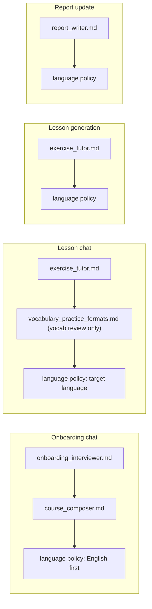

# AI integration

The coach is Google Gemini called through LangChain (`langchain-google-genai`). Its behavior is the markdown in [`apps/backend/skills/`](../../apps/backend/skills/README.md); the backend adds Pydantic response schemas, a language policy, and per-call context. Identifiers and settings are provider-agnostic (`LLM_*`); `LLM_PROVIDER=google` is the only provider implemented.

## Call types

| Call type | Trigger | Function | Model setting | Output |
|-----------|---------|----------|---------------|--------|
| `chat` | Every chat message (onboarding and lesson) | `generate_structured` | `GEMINI_MODEL_CHAT` | `OnboardingReply` or `LessonReply` |
| `lesson_json` | Lesson generation job | `generate_structured` | `GEMINI_MODEL_LESSON` | `LessonCurriculum` |
| `report` | Lesson finish | `generate_structured` | `GEMINI_MODEL_LESSON` | `ReportPatch` |

Lesson, report, and chat go through [`metered_structured_call`](../../../../apps/backend/app/services/llm_usage.py). That reserves one Gemini call, then [`generate_structured`](../../../../apps/backend/app/services/gemini.py) builds a `ChatGoogleGenerativeAI` client with `max_retries=0` and `GEMINI_TIMEOUT_SECONDS` (default 120). The client kwargs do not set a JSON mime type. The call is `with_structured_output(Model, method="json_schema", include_raw=True)`. LangChain owns the schema and the parse. Callers persist `model_dump()`. A schema failure is not retried.

`_tokens` reads `usage_metadata` on the raw `AIMessage` for a success and for a failed parse. A finished call reports that input count, then returns the model or raises `LLM_SCHEMA_ERROR`. Transport failures are recorded with zero tokens and do not report usage. The quota row stays on the reserve estimate only in that case.

Failures become `GeminiError` with a code:

| Code | Cause |
|------|-------|
| `LLM_CONFIG_ERROR` | `GEMINI_API_KEY` is empty |
| `LLM_TIMEOUT` | No response within the timeout |
| `LLM_QUOTA_EXCEEDED` | Gemini returned `RESOURCE_EXHAUSTED` |
| `LLM_SCHEMA_ERROR` | A finished call did not yield a valid model, including a blank reply |
| `LLM_API_ERROR` | Anything else |

Chat maps those codes onto HTTP status with a fixed, learner-safe `detail` per code (`public_detail`); the provider's raw error text is only logged (`chat_llm_failed`). See [backend.md](./backend.md#chat-turn).

## System instruction assembly

- Skill files are read once from `SKILLS_DIR` and cached. Files inside one mode are joined with `---` separators. [`prompt_assembly.py`](../../../../apps/backend/app/services/prompt_assembly.py) then appends the language policy. It does not append an output contract.
- `vocabulary_practice_formats.md` is appended when any curriculum slot id or label contains a vocab-review marker (`vocab_review`, `vocabulary_review`, `weekend_vocab`, `weekly_vocab`, `vocab review`).
- Field descriptions live on the models in [`schemas/llm.py`](../../../../apps/backend/app/schemas/llm.py). `extra="ignore"`, so unknown keys are dropped. Pedagogy stays in the skill files.
- **Language policy.** During onboarding, before both languages are known, the coach starts in English, asks for the native and then the target language, and then switches. Everywhere else all learner-facing text is in the target language (default `en`), the native language is used only to anticipate interference, and JSON keys stay English.

## Context per call

Selection follows [rag.md](./rag.md) stage 1: each call gets the memory that fits it, not everything.

| Call | Messages sent after the system instruction |
|------|---------------------------------------------|
| Onboarding chat | The last `CHAT_CONTEXT_MESSAGES` turns (default 10), ending with the new message |
| Lesson chat | One context turn, then the last turns as above. The context turn holds the curriculum JSON, the learner's languages, goal, and level, and up to 10 mistakes whose review date is due |
| Lesson generation | One user turn with a JSON context: lesson number, accepted roadmap, current milestone, learner profile columns, the last 5 finished lessons (curriculum and summary), and all mistakes |
| Report update | One user turn: lesson number and date, session summary, this lesson's mistakes, pace status, and the current body of every report |

Chat history is the saved assistant prose. Metadata is not sent back. The lesson-context turn is not written to the transcript. Chat history is never used to build lesson generation or report context; those read the stored artifacts.

## Response models

Models are in [`schemas/llm.py`](../../../../apps/backend/app/schemas/llm.py). `content` on a chat reply is stripped, and a blank reply fails validation (`LLM_SCHEMA_ERROR`). There is no second `task_update` object: `completed_task_ids` on `LessonReply` is the only source.

| Model | Required | Defaults |
|-------|----------|----------|
| `LessonCurriculum` | `lesson_goal`, `grammar_focus`, `vocab_theme`, `milestone_index`, `slots` (at least one), `input_task`, `goal_specific_task`, `exit_criteria`. Each slot requires `id`, `label`, and `exercise_set`. Input and goal tasks require their fields | `partner_session` is null. `model_dump()` always writes that key. A curriculum without slots fails the job |
| `ReportPatch` | Each op requires `report_type` (`progress`, `errors_log`, `roadmap`, `four_week_plan`), `op` (`append_entry` or `patch_section`), `section_id`, and `markdown` | `ops` is `[]`. `append_entry` adds a dated log line; `patch_section` replaces the section. `section_id` must match an existing `<!-- section:ID -->` marker. One invalid op fails the whole parse |
| `OnboardingReply` | `content`. A present `learner_profile` requires non-empty `languages.native` and `languages.target`. A present `course_roadmap` requires `version`, `summary` (`goal_outcome`, `goal_horizon`, `starting_level`, `target_plan_days`), and `milestones` (at least one, each with `index` and `title`) | `learner_profile` and `course_roadmap` are null. Include `learner_profile` only once both languages are known, and again when they change. Set `course_roadmap` to the full object on a new or revised plan, and leave it null on a clarifying question. There is no `onboarding_complete` field |
| `LessonReply` | `content`. A correction requires `span`, `correction`, and `type` (`note` is optional). A mistake requires `pattern_type`, `example_text`, and `correction`. A present `lesson_plan` has `tasks` of at least one, each with `id`, `label`, and `minutes` | `corrections`, `tips`, `mistakes`, and `completed_task_ids` are empty. `suggest_finish` is false, and is set only when every slot and exit criterion is done. `plan_updates` and `lesson_plan` are null. Include `lesson_plan` on the first coaching turn and when the agenda changes |

`plan_updates` uses the keys lesson chat already applies, all optional: `goal_summary`, `level`, `time_budget`, `topics`, `vocab_priorities`, `target_plan_days`, `grammar_mastery`. Goal, level, time budget, focus, constraints, and motivation on `learner_profile` are optional and match the profile fields chat already writes.

The other `CourseRoadmap` fields stay optional: summary language fields, `weekly_template`, `current_block`, `learning_principles`, `adaptation_rules`, and `current_milestone_index`. When `weekly_template` is present it requires `minutes_per_session` and `activities` (each activity requires `id`, `label`, and `minutes`). When `current_block` is present it requires `milestone_index`; each theme requires `block_day`. A present `target_plan_days_range` must be two integers. A roadmap missing the core above fails the turn. `model_dump()` of a present roadmap is `course_roadmap_draft`.

## Lesson generation output

The job stores `LessonCurriculum.model_dump()`, including `"partner_session": null`. The user prompt still asks for one grammar focus and one vocab theme aligned to the current milestone, review of due mistakes and prior lessons before new material, and reading and writing work only (no speaking slots, no URLs).

## Report update output

`ReportPatch.ops` is applied by [`services/report_ops.py`](../../../../apps/backend/app/services/report_ops.py) inside the matching `<!-- section:ID --> … <!-- /section:ID -->` markers. `append_entry` adds the markdown after the existing content; `patch_section` replaces it. An unknown section id is skipped. If the whole call fails, the lesson still finishes and the reports stay as they were.

## Limits around every call

Each call is reserved in `llm_usage_events` before it starts (`len` of the system instruction and history `// 4`) and completed afterwards (see [backend.md](./backend.md#limits)). A known input count is stored for both `ok` and `error`. The estimate remains only when usage never arrived. Chat messages also count against the per-user hourly chat limit, and lesson starts against the per-user daily start limit. One chat turn is one reserved Gemini request. The hourly check stays in front of the reserve.
