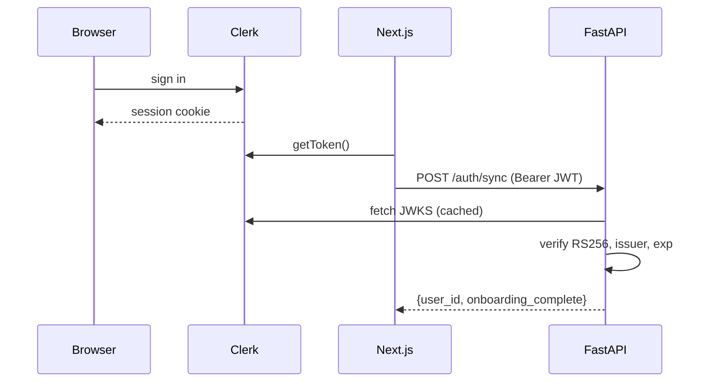
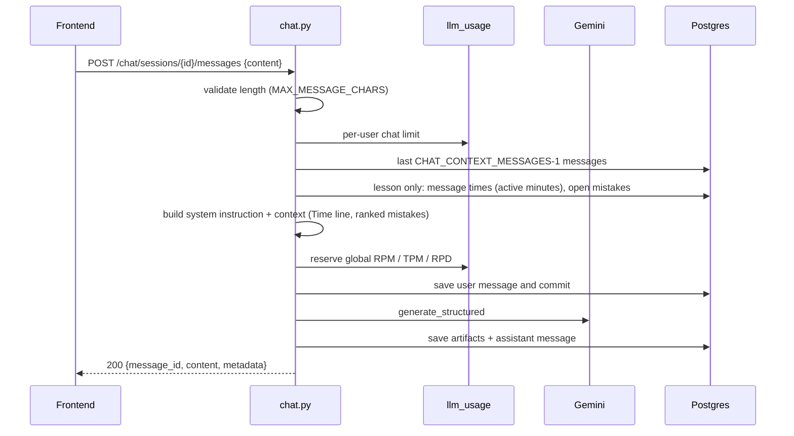
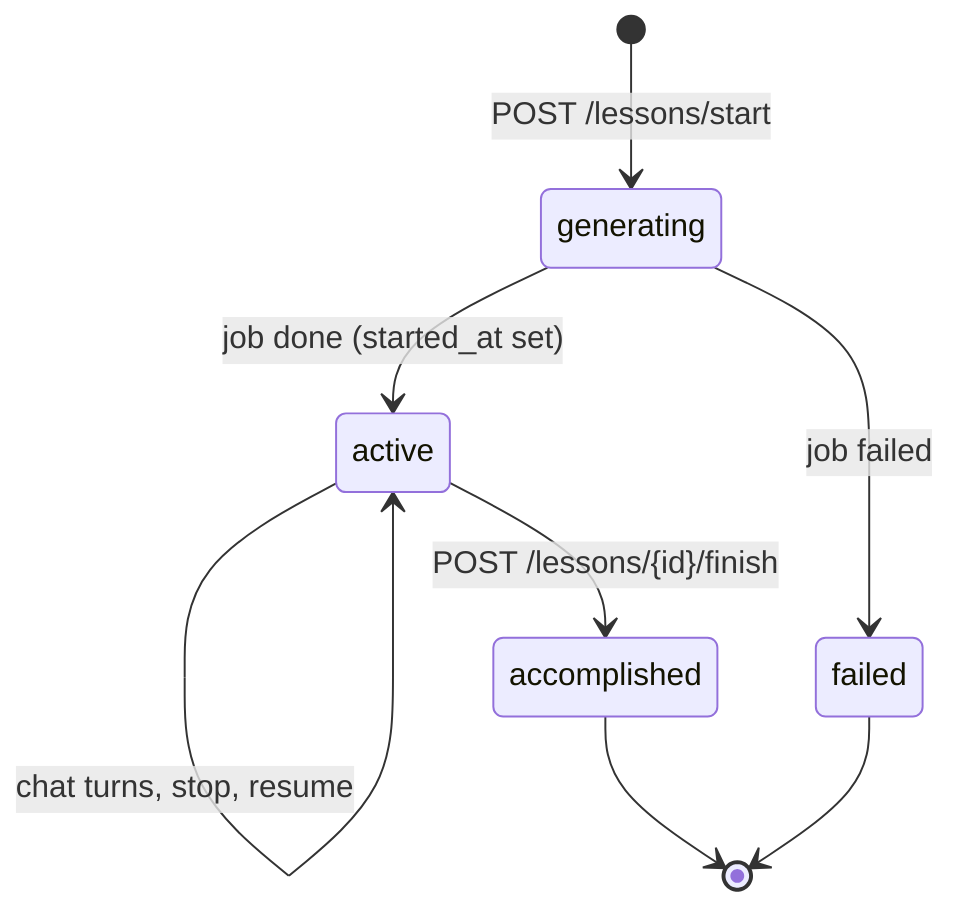
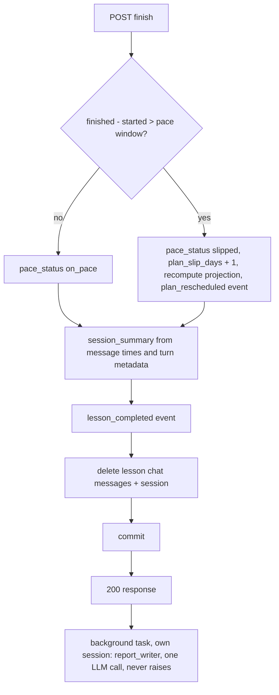

# Backend

FastAPI service in [`apps/backend`](../../apps/backend). It authenticates Clerk users, stores learner data in Postgres, runs the coach chat as one JSON response per turn, generates lessons in a background task, and exposes Prometheus metrics.

## Layout

```
apps/backend/
  app/
    main.py            app, middleware, exception handlers, /metrics
    config.py          settings from environment / .env
    api/deps.py        Clerk principal, current user, onboarding gate, get_owned
    api/v1/            routers: health, auth, chat, onboarding, profile, progress, reports, lessons, jobs
    core/              clerk_auth (JWKS), errors, logging (JSON), metrics, request-id middleware
    db/                engine and AsyncSession factory
    models/            SQLAlchemy tables (see database.md)
    schemas/           HTTP models, plus LLM response models in llm.py
    services/
      structured_llm.py    generate_structured: one structured-output LLM call (Gemini via LangChain)
      skills.py            loads skills/*.md
      prompt_assembly.py   joins skill markdown, the language policy and per-call context
      memory.py            stage-1 retrieval: rank_mistakes, prior-lesson one-liners
      lesson_timing.py     active minutes, lesson target (TIME_BUDGET_REQUIRED)
      lesson_generation.py background job that writes a curriculum; stale-generation reaper
      report_writer.py     background job that patches the markdown reports after a lesson
      report_seed.py       initial report markdown
      report_ops.py        append_entry / patch_section, log tails, log-section guard
      pace.py              pace status, projection, pace window, pace snapshot
      queries.py           shared reads: profile, active lesson, accomplished count
      llm_usage.py         per-user and global LLM limits, @traceable metered call
  skills/              coach pedagogy as markdown (loaded at runtime)
  evals/               LangSmith datasets, deterministic evaluators, runner (see evals.md)
  tests/               pytest: unit/, integration/, api/, contract/, eval/
  alembic/             migrations
```

Routers hold the orchestration for their flow. Services hold anything shared between routers or anything that talks to the LLM.

## Endpoints

All routes are under `/api/v1` and, except `health`, require `Authorization: Bearer <Clerk session JWT>`.

| Method | Path | Gate | Purpose |
|--------|------|------|---------|
| GET | `/health` | none | Liveness |
| POST | `/auth/sync` | token | Upsert the `users` row for the Clerk user; returns `onboarding_complete` |
| POST | `/chat/sessions` | synced user | Get or create the onboarding session, or the session for a lesson (`{type, lesson_id?}`) |
| GET | `/chat/sessions/{id}/messages` | owner | Transcript with per-message metadata |
| POST | `/chat/sessions/{id}/messages` | owner | Send a message; `200` `ChatTurnResponse` |
| POST | `/onboarding/accept` | synced user | Accept a roadmap (`{session_id, course_roadmap}`, roadmap validated as `CourseRoadmap`) |
| GET | `/profile` | synced user | Profile summary plus schedule and pace |
| PATCH | `/profile` | synced user | Set the lesson length: `{"time_budget": {"minutes_per_session": 5..180}}`, merged into `time_budget`; returns the profile (`404 NOT_FOUND` without a profile) |
| GET | `/progress` | onboarded | Plan days done, target, slip, projection, pace summary, active lesson |
| GET | `/reports/{report_type}` | onboarded | One markdown report (`progress`, `errors_log`, `roadmap`, `four_week_plan`) |
| POST | `/lessons/start` | onboarded | Create lesson N+1 and a generation job; `202 {job_id, lesson_id, lesson_number}` |
| GET | `/lessons/active` | onboarded | The generating or active lesson, or `null` |
| GET | `/lessons/{id}` | onboarded, owner | One lesson with its payload |
| POST | `/lessons/{id}/stop` | onboarded, owner | Leave the chat; logs `lesson_chat_stopped` |
| POST | `/lessons/{id}/finish` | onboarded, owner | Finish an active lesson (`{learner_feedback?}`) |
| GET | `/jobs/{id}` | owner | Generation job status: `pending`, `running`, `done`, `failed` |
| GET | `/metrics` | none | Prometheus exposition (when `METRICS_ENABLED`) |

"Synced user" means a `users` row exists (`401 USER_NOT_SYNCED` otherwise). "Onboarded" adds `users.onboarding_complete` (`403 ONBOARDING_INCOMPLETE` otherwise).

Ids in paths (`/lessons/{id}`, `/chat/sessions/{id}`, `/jobs/{id}`) and in bodies (`lesson_id`, `session_id`) are typed `uuid.UUID`: a malformed id is FastAPI's `422` validation error (body `{"detail": [...]}`, no `code`). A well-formed id that does not exist or belongs to someone else is `404 NOT_FOUND` (`api/deps.get_owned`), so ownership is never revealed. Clients should treat both as "not found".

## Authentication



[`core/clerk_auth.py`](../../apps/backend/app/core/clerk_auth.py) verifies the token against the issuer's JWKS. The issuer must equal `CLERK_JWT_ISSUER`. That setting is **required whenever `APP_ENV` is not `local`**: the app refuses to start without it, because otherwise a token minted by anyone's Clerk development instance would be trusted. Only with `APP_ENV=local` and no issuer configured is any `https://*.clerk.accounts.dev` issuer accepted. If the token carries an `azp` (authorized party) claim, it must be one of `CORS_ORIGINS`; otherwise `401 INVALID_TOKEN`.

## Chat turn

One endpoint serves both onboarding and lesson chat. The session type decides the skills and the artifacts.



The body is `ChatTurnResponse`: `message_id`, `content`, and `metadata`. History sent to the model is the saved assistant prose. The lesson-context turn is not written back.

Artifacts saved per session type:

- **Onboarding**: a present `learner_profile` upserts `profiles` and the draft `learning_goals` row. `metadata.course_roadmap_draft` is the present `course_roadmap` and is not stored until accept. `plan_updates` holds `goal_summary` and `level` only when a profile was saved.
- **Lesson**: `practiced` results are applied first (see [ai-api.md](./ai-api.md#lesson-chat-time-and-practice)), then mistakes are upserted with `INSERT … ON CONFLICT (user_id, pattern_type) DO UPDATE` after deduping the reply by `pattern_type`, then plan updates patch the profile and write a `plan_updated` event. `suggest_finish` is forced to `false` while `active_minutes < target_minutes - 1`.

`metadata` is the typed `TurnMetadata` and always has these keys (each defaults as shown):

| Key | Type | Default |
|-----|------|---------|
| `corrections` | list of `{span, correction, type, note}` | `[]` |
| `tips` | list of strings | `[]` |
| `plan_updates` | object or null | `null` |
| `suggest_finish` | bool | `false` |
| `course_roadmap_draft` | `CourseRoadmap` or null | `null` (onboarding only) |
| `practiced` | list of `{aspect, item, result}` | `[]` (lesson only) |
| `timing` | `{active_minutes, target_minutes}` or null | `null` (lesson only; null for a legacy lesson whose learner has no lesson length). Measured right before the reply is saved |

It is stored on the assistant message so the transcript reloads with the same state; the UI restores `timing` from the latest assistant message. Messages written before this change may still carry the retired `lesson_plan` and `task_update` keys; `GET …/messages` returns stored metadata as-is. A blank `content` fails schema validation and never reaches persist.

The user row is committed before the LLM call. LLM failures use the `{detail, code}` body with a fixed learner-safe `detail` per code (the provider's error text is logged, never returned) and save no assistant row:

| Code | Status |
|------|--------|
| `LLM_TIMEOUT` | 504 |
| `LLM_QUOTA_EXCEEDED` | 429 |
| `LLM_SCHEMA_ERROR`, `LLM_API_ERROR`, `LLM_CONFIG_ERROR` | 502 |
| `PERSIST_FAILED` | 500 |

`PERSIST_FAILED` happens after a valid model, so the usage row stays `ok`. The user row stays; the assistant row does not.

## Onboarding accept

`POST /onboarding/accept` validates `course_roadmap` as `CourseRoadmap` (a malformed roadmap is `422`; unknown keys are dropped, because the stored roadmap feeds later prompts). It requires the onboarding session, a draft goal (`422 ONBOARDING_INTERVIEW_INCOMPLETE`), and a lesson length in `profiles.time_budget.minutes_per_session` (`422 TIME_BUDGET_REQUIRED`). In one transaction it:

1. inserts an `accepted` `learning_plans` row with the validated roadmap's `model_dump()`;
2. points `profiles.active_learning_plan_id` at it, sets `target_plan_days` from `roadmap.summary.target_plan_days`, and sets `projected_completion_at = now + target × pace window`;
3. activates the goal and sets `users.onboarding_complete` and `plan_accepted_at`;
4. seeds the Roadmap and 4-Week Plan reports from the roadmap;
5. deletes the onboarding messages and session.

## Lesson lifecycle



**Start.** In order:

1. `409 TIME_BUDGET_REQUIRED` when the profile has no `time_budget.minutes_per_session` (profiles from before lesson timing). The dashboard asks for the minutes, saves them with `PATCH /profile`, and retries.
2. Stale generation is reaped: a `generating` lesson (and its `pending`/`running` job) older than `LLM_TIMEOUT_SECONDS × 2` lost its background task to a restart, so both become `failed`. `GET /jobs/{id}` reaps too, so a polling client sees `failed`, and active-lesson reads ignore stale rows.
3. `409 ACTIVE_LESSON_EXISTS` (with `active_lesson_id`) when a lesson is generating or active.
4. The per-user lesson-start limit.
5. The lesson (`lesson_number = max + 1`) and a `jobs` row are inserted. A unique partial index allows one generating/active lesson per user, so a concurrent start that slips past step 3 fails on commit and is answered `409 ACTIVE_LESSON_EXISTS` too.
6. `run_lesson_generation_job` is scheduled with FastAPI `BackgroundTasks`.

**Generation job.** Runs after the response, in its own DB session. It marks the job `running`, reads the accepted roadmap, profile, prior lessons and ranked mistakes (see [ai-api.md](./ai-api.md#context-per-call)), and makes one structured LLM call. Success stores `payload = {version: 1, curriculum, session_summary: null, target_minutes}`, sets the lesson `active` with `started_at = now`, and marks the job `done` with `result_ref = lesson_id`. Any exception marks both the job and the lesson `failed`; `job.error` is a generic message (the raw error is logged).

**Stop.** Writes a `lesson_chat_stopped` event. The lesson, session, and transcript stay.

**Finish.** Only from `active`. The learner can finish at any time; an early finish still counts as an accomplished plan day.



Two updates close together are serialized without holding a lock during the LLM call: after the call, the writer re-reads the user's report rows `SELECT … FOR UPDATE` and applies its ops to those fresh bodies, so the later update waits for the earlier commit instead of overwriting it. The report update runs after the response so finish holds no transaction or pooled connection open during an LLM call of up to `LLM_TIMEOUT_SECONDS`. If it fails, the lesson stays finished and the reports simply miss that lesson.

`session_summary` is built by the backend before the chat rows are deleted:

| Field | Value |
|-------|-------|
| `duration_minutes` | Active minutes (idle gaps capped), not wall time |
| `target_minutes` | `payload.target_minutes`, or the profile's lesson length for a legacy lesson |
| `shortfall_minutes`, `finished_early` | `max(target - active, 0)` and `shortfall > 1` (the guard's one-minute tolerance: 14 of 15 is a full lesson) |
| `practiced_solid`, `practiced_shaky` | The last reported result per practiced item across the lesson's turns |
| `resolved_pattern_types` | Mistake patterns closed since the lesson started |
| `new_pattern_types` | Patterns first created in this lesson (a pattern that only recurred is not new) |
| `new_vocabulary` | `curriculum.new_vocabulary` |
| `grammar_focus`, `vocab_themes_covered`, `learner_feedback` | From the curriculum and the request |

The response is `{status: "accomplished", accomplished_at, pace_status, schedule_updated}`.

## Pace

[`services/pace.py`](../../apps/backend/app/services/pace.py) is shared by finish, chat plan updates, accept, `/progress`, and `/profile` (`pace_snapshot` gives the last two the same profile, counts, active lesson and summary).

- Pace window: `profiles.pace_window_hours`, falling back to `PACE_WINDOW_HOURS` (default 24).
- Lesson status: `slipped` when elapsed hours exceed the pace window, else `on_pace`.
- Projection: `now + remaining plan days × pace window`.
- Summary: `not_started` before any lesson; `behind` if the active lesson is past its window or the last finished lesson slipped; `ahead` if the last lesson took at most half the window and `plan_slip_days == 0`; otherwise `on_pace`.

## Limits

[`services/llm_usage.py`](../../apps/backend/app/services/llm_usage.py) counts rows in `llm_usage_events`, so limits hold across restarts and processes. Rows are written on a separate session so they commit even if the caller's transaction is still open. The global minute and day windows are read in one query. These are soft limits: the check and the insert are not atomic across processes, so concurrent requests can slightly overshoot a nearly full window.

| Limit | Default | Window | Error |
|-------|---------|--------|-------|
| Chat messages per user | 60 | rolling hour | `429 RATE_LIMIT_EXCEEDED` |
| Lesson starts per user | 2 | rolling 24h | `429 RATE_LIMIT_EXCEEDED` |
| LLM requests (all users) | 15 | rolling minute | `429 LLM_RATE_LIMIT_EXCEEDED` |
| LLM input tokens (all users) | 250,000 | rolling minute | `429 LLM_RATE_LIMIT_EXCEEDED` |
| LLM requests (all users) | 500 | rolling 24h | `429 LLM_RATE_LIMIT_EXCEEDED` |

Each LLM call is reserved before it runs (input tokens estimated at 4 characters per token) and completed afterwards as `ok` or `error`. A known input count is stored for both statuses. The estimate remains only when usage never arrived. `max_retries=0`. A schema failure is not retried. All 429s from these limits carry `Retry-After`.

## Errors and logging

- Every error body is `{"detail": "...", "code": "MACHINE_CODE", ...extra}`, except FastAPI's own request-validation `422` (`{"detail": [...]}`). Unhandled exceptions become `500 INTERNAL_ERROR`.

| Code | Status | When |
|------|--------|------|
| `UNAUTHORIZED`, `INVALID_TOKEN`, `USER_NOT_SYNCED` | 401 | Auth (see above) |
| `ONBOARDING_INCOMPLETE` | 403 | Onboarded-only routes |
| `NOT_FOUND` | 404 | Missing or someone else's resource (well-formed id) |
| `ACTIVE_LESSON_EXISTS` | 409 | Start while a lesson is generating or active (`active_lesson_id`) |
| `TIME_BUDGET_REQUIRED` | 409 | `POST /lessons/start` for a profile without a lesson length |
| `TIME_BUDGET_REQUIRED` | 422 | `POST /onboarding/accept` for a profile without a lesson length |
| `LESSON_NOT_ACTIVE` | 409 | Finish or open a chat for a lesson that is not active |
| `ONBOARDING_INTERVIEW_INCOMPLETE`, `LESSON_ID_REQUIRED`, `EMPTY_MESSAGE`, `MESSAGE_TOO_LONG` | 422 | Business validation |
| `RATE_LIMIT_EXCEEDED`, `LLM_RATE_LIMIT_EXCEEDED` | 429 | Limits, with `Retry-After` |
| LLM codes, `PERSIST_FAILED` | 429/502/504/500 | See [Chat turn](#chat-turn) |
- The request-id middleware reads or creates `X-Request-ID`, echoes it on responses, and logs one JSON access line per request (`/metrics` and `/health` are skipped).
- LLM calls log `llm_call` with call type, model, status, latency, and tokens; prompt builders log `prompt_context` with `context_tokens` per block; rejected report ops log `report_op_rejected`; renamed env vars log `deprecated_env_var` at startup.

## Metrics

`prometheus-fastapi-instrumentator` provides HTTP request counts and latency. [`core/metrics.py`](../../apps/backend/app/core/metrics.py) adds:

| Metric | Labels |
|--------|--------|
| `llm_requests_total` | `call_type`, `model`, `status` |
| `llm_tokens_total` | `call_type`, `model`, `direction` |
| `llm_request_duration_seconds` | `call_type`, `model` |

`call_type` is `chat`, `lesson_json`, or `report`.
