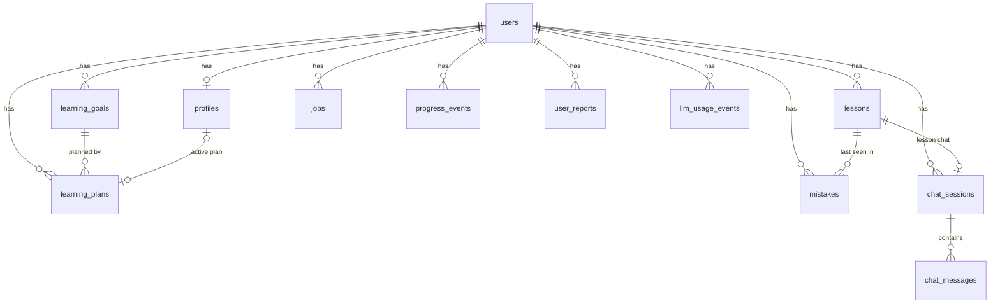
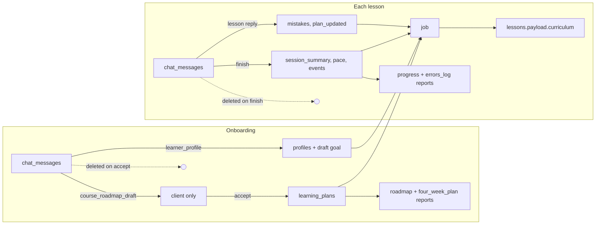

# Database

PostgreSQL 16 is the system of record. Models are SQLAlchemy 2 (async, `asyncpg`) in [`apps/backend/app/models/`](../../apps/backend/app/models); migrations are Alembic in [`apps/backend/alembic/versions/`](../../apps/backend/alembic/versions). Clerk owns sign-in sessions; the database stores only `clerk_user_id`.

The database stores what the coach learned about the learner as structured data. Chat transcripts are kept only while a conversation is open.

## Entity map



Every table has a UUID `id` and `created_at` / `updated_at` timestamps.

## Tables

### `users`

| Column | Type | Notes |
|--------|------|-------|
| `clerk_user_id` | varchar(255), unique | Clerk `sub` |
| `email` | varchar(320), nullable | Only when the Clerk token carries an `email` claim |
| `onboarding_complete` | bool | Set on plan accept |
| `plan_accepted_at` | timestamptz, nullable | Set on plan accept |

Created by `POST /auth/sync`.

### `profiles` (one per user)

Written from the onboarding reply's `learner_profile`, then by plan accept, lesson finish, and chat plan updates.

| Column | Type | Source |
|--------|------|--------|
| `user_id` | FK, unique | |
| `goal_outcome`, `goal_horizon` | text | `goal.outcome`, `goal.horizon` |
| `goal_success_criteria` | JSONB list | `goal.success_criteria` |
| `native_language`, `target_language` | text | `languages.native`, `languages.target` (stored as sent, trimmed) |
| `target_level` | text | `level.self_assessed` |
| `level_strengths`, `level_weaknesses` | JSONB list | `level.*` |
| `diagnostic_notes` | text | `level.diagnostic_notes` |
| `time_budget` | JSONB | `{minutes_per_session, sessions_per_week, intensity}`. `minutes_per_session` (5–180) is the lesson length: required at accept and before a lesson starts; set by onboarding, chat `plan_updates` (merged), or `PATCH /profile` |
| `focus` | JSONB | `{skill_priorities, topic_priorities, vocab_priorities, avoid}` |
| `constraints`, `motivation` | JSONB | Interview answers |
| `interview_completed_at` | timestamptz | Last `learner_profile` save |
| `grammar_mastery` | JSONB | Merged from chat `plan_updates.grammar_mastery` and from `solid` grammar results in `practiced` (`{point: "solid"}`) |
| `vocabulary_summary`, `confidence_flags` | JSONB | Passed into lesson generation |
| `target_plan_days` | int | From the accepted roadmap or chat `plan_updates` |
| `active_learning_plan_id` | FK → `learning_plans` | Set on accept |
| `projected_completion_at` | timestamptz | `now + remaining days × pace window` |
| `plan_slip_days` | int, default 0 | +1 per slipped lesson |
| `pace_window_hours` | int, default 24 | From `PACE_WINDOW_HOURS` at creation |

### `learning_goals`

`goal_statement`, `horizon`, `success_criteria` (JSONB), `status` (`draft` → `active` → `archived`). The draft row is written with the learner profile; accept activates it.

### `learning_plans`

| Column | Type | Notes |
|--------|------|-------|
| `learning_goal_id` | FK | |
| `status` | `accepted` \| `superseded` | |
| `roadmap` | JSONB | The accepted `course_roadmap`, validated as `CourseRoadmap` and stored as `model_dump()` |
| `current_milestone_index` | int | From `roadmap.current_milestone_index` |
| `accepted_at`, `superseded_at` | timestamptz | |

Roadmap shape (written by the `course_composer` skill). Drafts and the accepted row are `model_dump()` of `CourseRoadmap`, so omitted optional fields are null and unknown keys are dropped. Rows accepted before the time-boxed lessons change may still hold `weekly_template.activities` and the old theme fields; readers ignore them (`extra="ignore"`, `.get()` with defaults):

```json
{
  "version": 1,
  "summary": {
    "goal_outcome": "...", "goal_horizon": "...", "starting_level": "B1",
    "target_language": "es", "native_language": "en",
    "target_plan_days": 90, "target_plan_days_range": [80, 100],
    "pace_description": "..."
  },
  "milestones": [{ "index": 0, "title": "...", "skill_developed": "...", "success_criteria": "...", "estimated_plan_days": 5 }],
  "weekly_template": { "minutes_per_session": 15, "sessions_per_week": 5, "weekends": "light review" },
  "current_block": { "milestone_index": 0, "weeks": 4, "focus_summary": "...", "themes": [{ "block_day": 1, "grammar_focus": "...", "vocab_theme": "...", "goal_context": "..." }] },
  "learning_principles": ["active_recall", "spaced_repetition"],
  "adaptation_rules": { "recurring_error_pattern": "inject_retrieval_drill" },
  "current_milestone_index": 0
}
```

### `lessons`

| Column | Type | Notes |
|--------|------|-------|
| `learning_goal_id`, `learning_plan_id` | FK, nullable | Active goal and plan at start |
| `lesson_number` | int | `max + 1` per user; unique with `user_id` |
| `status` | `generating` \| `active` \| `accomplished` \| `failed` | |
| `payload` | JSONB | See below |
| `started_at` | timestamptz | Set when generation succeeds; starts the pace window |
| `accomplished_at` | timestamptz | Set on finish |
| `pace_status` | `on_pace` \| `slipped` | Set on finish |

Unique partial index `uq_lessons_user_id_active` on `user_id` where status is `generating` or `active`: at most one in-flight lesson per user, enforced by the database (a concurrent start gets `409`).

```json
{
  "version": 1,
  "target_minutes": 15,
  "curriculum": {
    "lesson_goal": "...", "grammar_focus": "...", "vocab_theme": "...", "milestone_index": 0,
    "new_vocabulary": ["deadline", "blocker", "on track"],
    "review_patterns": ["missing articles"],
    "goal_context": "a status email to a client",
    "practice_targets": ["..."]
  },
  "session_summary": {
    "duration_minutes": 8,
    "target_minutes": 15,
    "shortfall_minutes": 7,
    "finished_early": true,
    "grammar_focus": "...",
    "practiced_solid": ["present perfect"],
    "practiced_shaky": ["missing articles"],
    "resolved_pattern_types": ["word order"],
    "new_pattern_types": ["missing articles"],
    "new_vocabulary": ["deadline", "blocker", "on track"],
    "vocab_themes_covered": ["..."],
    "learner_feedback": "..."
  }
}
```

`curriculum` is `LessonCurriculum.model_dump()` from the generation job; `target_minutes` is copied from the profile at generation. `session_summary` is `null` until finish. `duration_minutes` is active minutes (gaps between lesson-chat messages, each capped at `LESSON_IDLE_CAP_MINUTES`). Lessons created before this change may hold the old shape (`slots`, `input_task`, `exit_criteria`, `partner_session`, `completed_slots`, …); readers use `.get()` with defaults, a legacy active lesson keeps working, and its target falls back to the profile's lesson length. No data migration rewrites them.

### `jobs`

`type` (`lesson_generate`), `status` (`pending` → `running` → `done` | `failed`), `error`, `result_ref` (lesson id). Indexed on `(user_id, created_at)`. Kept indefinitely.

### `mistakes`

| Column | Type | Notes |
|--------|------|-------|
| `lesson_id` | FK, nullable | Lesson where it was last seen |
| `pattern_type` | varchar(255) | Short stable label in canonical form (whitespace collapsed, case-folded); unique per user (`uq_mistakes_user_id_pattern_type`) |
| `example_text` | text | Latest example |
| `correction` | text, nullable | |
| `occurrence_count` | int | +1 per log |
| `next_review_at` | timestamptz, nullable | `last_seen + 1, 3, 7` days for counts 1, 2, 3; then 14 days. A `solid` practiced result pushes it one step further; null once resolved |
| `solid_streak` | int, default 0 | Consecutive `solid` practiced results; reset by `shaky` or a new mistake |
| `resolved_at` | timestamptz, nullable | Set when solid results in two different lessons accumulate; cleared when the pattern recurs |
| `last_solid_lesson_id` | FK → `lessons`, nullable | Lesson of the last counted `solid`; the streak moves at most once per lesson |
| `last_seen_at` | timestamptz | |

Indexed on `(user_id, created_at)`. Written with `INSERT … ON CONFLICT (user_id, pattern_type) DO UPDATE`. Lesson chat sends the 10 best-ranked open (unresolved) mistakes, lesson generation the 15 best (see [ai-api.md](./ai-api.md#context-per-call)).

### `progress_events`

`event_type`, optional `lesson_id` and `chat_session_id`, `payload` JSONB. Indexed on `(user_id, created_at)`.

| Event | Written by | Payload |
|-------|------------|---------|
| `plan_updated` | Lesson chat `plan_updates` | The updates |
| `lesson_chat_stopped` | `POST /lessons/{id}/stop` | none |
| `lesson_completed` | Finish | `{lesson_number, pace_status}` |
| `plan_rescheduled` | Slipped finish | `{plan_slip_days}` |

### `chat_sessions` and `chat_messages`

- `chat_sessions`: `type` (`onboarding` | `lesson`), `lesson_id` (nullable). Unique partial indexes allow one onboarding session per user and one session per `(user_id, lesson_id)`; session creation is an `INSERT … ON CONFLICT DO NOTHING` against them.
- `chat_messages`: `session_id`, `role` (`user` | `assistant`), `content` (the learner-facing reply), `metadata` JSONB (`TurnMetadata`: `corrections`, `tips`, `plan_updates`, `suggest_finish`, `course_roadmap_draft`, `practiced`, `timing`; rows from before may carry the retired `lesson_plan` / `task_update`). Indexed on `(session_id, created_at)`. Message timestamps also measure active lesson minutes, and assistant `practiced` lists feed the session summary, so both are read at finish before the rows are deleted.

### `user_reports`

`report_type` (`progress`, `errors_log`, `roadmap`, `four_week_plan`), `body` (markdown). Unique on `(user_id, report_type)`.

| Report | Seeded | Sections |
|--------|--------|----------|
| `roadmap` | On accept, from the roadmap | `overview`, `milestones`, `principles`, `scope_notes` |
| `four_week_plan` | On accept, from the roadmap | `block_overview`, `day_by_day`, `weekly_template` |
| `progress` | First finish, blank template | `latest_session`, `progress_table`, `update_log` |
| `errors_log` | First finish, blank template | `pattern_tracker`, `daily_log`, `confusion_list` |

Sections are delimited by `<!-- section:ID -->` and `<!-- /section:ID -->`; the report writer patches inside them. `update_log` and `daily_log` are append-only logs: the model sees only their last 5 entries and may not `patch_section` them. The progress table rows are Grammar, Vocabulary, Reading, Writing, Goal-specific (no Listening or Speaking).

### `llm_usage_events`

`call_type` (`chat`, `lesson_json`, `report`, `lesson_start`), `model`, `input_tokens`, `status` (`reserved`, `ok`, `error`). Indexed on `created_at` and on `(user_id, created_at, call_type)`. The rate limits count these rows over rolling windows. A known input count is stored for both `ok` and `error`. The reserve estimate remains only when the call never reported usage.

## Data lifecycle



| Data | Kept |
|------|------|
| Users, profiles, goals, plans, lessons, mistakes, events, reports, jobs, usage events | Indefinitely |
| Onboarding session and messages | Until plan accept |
| Lesson session and messages | Until lesson finish |

## Migrations

Applied in order: `c7be51ce9fe6` initial schema → `d8a4c2e91f0b` chat session uniqueness → `e3f9a1c82d4b` user reports → `f4a7b2c91e3d` profile languages → `a8f3c1d92e4b` quality events → `b1e7c4a92f30` LLM usage events → `c2d5e8f1a3b7` drops the quality events table (irreversible) → `9a1f3c5e7b2d` unique active lesson per user and unique `(user_id, pattern_type)` mistakes, after merging existing duplicates (extra in-flight lessons become `failed`; duplicate mistakes collapse into the latest row with summed counts; the merge is not undone on downgrade) → `b4c8d2e6f0a1` `mistakes.solid_streak`, `resolved_at` and `last_solid_lesson_id`. Run `uv run alembic upgrade head` from `apps/backend`; Compose does this on backend start. `tests/integration/test_migrations.py` checks the merge and a downgrade/upgrade round trip on a scratch database.

## Access rules

Every query is scoped by the authenticated user's id in the API layer. Credentials come from `DATABASE_URL`; no API keys are stored in the database.
