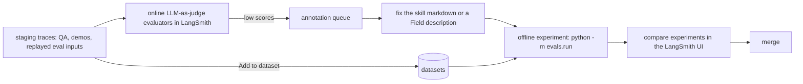

# Evals

How we check that the coach still behaves after a change to a skill, a schema description, the prompt context, or the model. Unit tests prove the plumbing; evals score what the model actually writes. Code lives in [`apps/backend/evals/`](../../apps/backend/evals).

## The loop



- **Tracing** is on in `local` and `staging` (`LANGSMITH_TRACING=true`, one project per environment) and never in production: the app refuses to start with `APP_ENV=production` and tracing on. Staging holds only test accounts, so no learner data reaches LangSmith. Each LLM call is a run named after its call type (`chat`, `lesson_json`, `report`) with tags `[call_type, env:<APP_ENV>]` and metadata (`lesson_number` or `session_type`, `user_id_hash`). The quota step (`metered_structured_call`) is a parent run.
- **Offline experiments** run a dataset through the production prompt builders against the real model and score the outputs.
- **CI**: [`.github/workflows/evals.yml`](../../.github/workflows/evals.yml) runs every dataset nightly and on `workflow_dispatch`. A run fails when any evaluator's mean score drops below `--min-score` (default 0.9). It is never part of the PR gate: it is nondeterministic and costs money.

## Datasets

One per call type, seeded from `evals/datasets/<name>.jsonl` the first time the runner sees it missing in LangSmith. Each line is `{"inputs": …, "outputs": {"expect": "…"}, "metadata": {"judge": "…"}}`; `outputs.expect` is the human expectation an LLM-as-judge evaluator compares against.

| Dataset | Inputs | Seeded cases |
|---------|--------|--------------|
| `onboarding_turns` | languages, history | one question per turn; vague minutes → ask again for a number; answers in another language accepted; hand-off produces a roadmap with the lesson length |
| `lesson_turns` | curriculum, `active_minutes`, `target_minutes`, ranked mistakes, history | fast learner at 6 of 15 min keeps practicing (no recap); "skip" gets a variant of the same item; recap and `suggest_finish` at 14 of 15; correction span comes from the message; Spanish target |
| `curriculum_gen` | the generation context JSON | sized to 10 vs 60 minutes; due mistake copied into `review_patterns`; shaky item from the last lesson revisited |
| `report_patch` | summary, mistakes, reports | first lesson appends to both logs; lesson 40 sees log tails and must not patch a log; early finish mentioned plainly |

The seeds are a handful of hand-written cases per dataset. Grow each to 20–50, mostly by promoting staging traces with "Add to dataset" in the UI.

## Evaluators

**Deterministic, in code** ([`evals/evaluators.py`](../../apps/backend/evals/evaluators.py), unit-tested in `tests/unit/test_eval_evaluators.py`):

| Key | Datasets | Passes when |
|-----|----------|-------------|
| `schema_parsed` | all | the reply parsed into the schema |
| `reply_language` | onboarding, lesson | the reply is in the target language (script check for Cyrillic, Greek, Arabic, Hebrew, CJK; stopword check for en/es/de/fr/it/pt; other languages are not scored) |
| `suggest_finish_respects_time` | lesson | `suggest_finish` is false while `active < target - 1` |
| `correction_spans` | lesson | every correction `span` appears in the learner's last message |
| `no_urls`, `no_speaking` | curriculum | no URL anywhere; no speaking/listening task (English keywords only) |
| `section_ids_exist` | report | every op names an existing section and no op patches `update_log` / `daily_log` |

**LLM-as-judge, in the LangSmith UI** so non-engineers can tune the rubric: pedagogy quality against `exercise_tutor.md`, correction accuracy, tone and level, one question per onboarding turn, "keeps practicing when fast", "offers a variant after a skip", report consistency with history. The `metadata.judge` field on each example names the rubric it is meant for.

## Running

```bash
cd apps/backend
export LANGSMITH_API_KEY=… GEMINI_API_KEY=… LANGSMITH_TRACING=true LANGSMITH_PROJECT=lingua-coach-evals
uv run python -m evals.run --dataset lesson_turns            # experiment prefix: git sha
uv run python -m evals.run --dataset report_patch --min-score 0.8
uv run pytest -m eval                                        # the same, as a pytest (skipped without keys)
```

The runner calls `generate_structured` directly with the same system instructions and prompt builders as the app (no database, no quota rows). Compare two prompt versions by running the dataset on each branch and opening both experiments side by side in LangSmith.

## Status

Implemented: tracing metadata and the production guard, the datasets' seed files, deterministic evaluators, the runner, the nightly workflow. Not yet done (needs accounts and infrastructure): the staging deployment itself, the LangSmith project setup, LLM-as-judge evaluators in the UI, and a first baseline experiment. [rag.md](./rag.md) stage 2 is gated on these evals.
