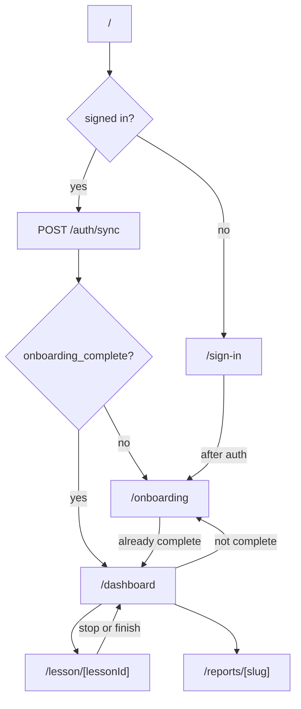
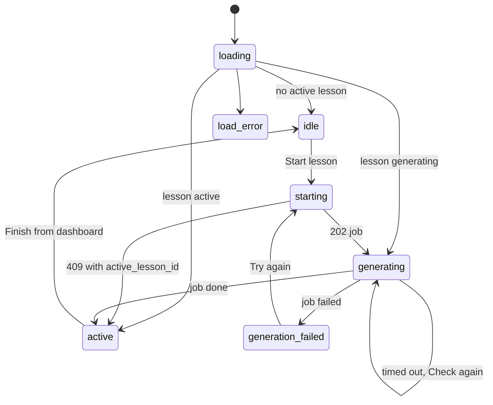

# Frontend

Next.js 16 App Router app in [`apps/frontend`](../../../../apps/frontend), with React 19, Tailwind CSS 4, and Clerk. It renders the screens and calls the FastAPI backend; all business rules live in the backend.

## Layout

```
apps/frontend/
  proxy.ts                 clerkMiddleware (Next.js 16 name for middleware.ts)
  app/
    layout.tsx             ClerkProvider, fonts, global styles
    page.tsx               root gate: sign-in, onboarding, or dashboard
    sign-in/[[...sign-in]] Clerk <SignIn>
    onboarding/            page (server) + OnboardingChat + PlanSummaryCard
    dashboard/             page (server) + DashboardClient + PaceSummary
    lesson/[lessonId]/     page (server) + LessonChat + LessonChecklist
    reports/[slug]/        page (server) + ReportBody, ReportSection, ReportTable
  components/              AppHeader, AccountMenu, ChatComposer, ChatMessageBubble,
                           FinishLessonDialog, PostAuthRedirect, RootAuthGate, ui/Button
  lib/
    api.ts                 apiFetch, ApiError, toApiError, syncUser
    chat.ts                sessions, messages, SSE parser, onboarding accept, types
    lessons.ts             start/active/get/stop/finish, job polling, finish hint
    progress.ts            GET /progress
    reports.ts             GET /reports/{type}, section parsing
    wait-for-token.ts      waits for Clerk to issue a JWT
```

Server components protect routes with `auth.protect()` and do the first fetch. Client components own interaction and streaming.

## Routing



`PostAuthRedirect` (on sign-in) and `RootAuthGate` (on `/`) cover the moment when Clerk has finished on the client but the server cookie is not ready yet; they poll `waitForToken` and then navigate.

Report slugs: `progress`, `errors`, `roadmap`, `four-week-plan`. The account menu links to each.

## API access

- `apiFetch(path, token, init)` prefixes the base URL, sets `Authorization: Bearer`, `Content-Type`, and a fresh `X-Request-ID`, and disables the Next fetch cache.
- The base URL is `API_URL` on the server (the Compose service name `http://backend:8000`) and `NEXT_PUBLIC_API_URL` in the browser (`http://localhost:8000`).
- `toApiError` turns a non-2xx response into `ApiError {status, code, message, requestId}`, reading `{detail, code}` when the body is JSON.

## Onboarding screen

[`OnboardingChat`](../../../../apps/frontend/app/onboarding/OnboardingChat.tsx) receives the session id and transcript from the server page.

- Messages stream through `streamChatMessage`. Tokens append to a live assistant bubble; `done` replaces it with the stored content and metadata.
- When a `done` carries `course_roadmap_draft`, the latest draft is shown in `PlanSummaryCard` (left panel on desktop, above the chat on narrow screens). Earlier drafts are marked superseded. The card tolerates missing fields because the backend stores the model's roadmap as sent.
- **Change** sends the hidden message "I'd like to change my plan." without showing it as a learner bubble.
- **Accept** posts `{session_id, course_roadmap}` to `/onboarding/accept` and navigates to `/dashboard`.

## Dashboard

[`DashboardClient`](../../../../apps/frontend/app/dashboard/DashboardClient.tsx) is a small state machine:



- Job polling: `GET /jobs/{id}` every 1.8 s, up to 85 attempts (about 150 s, above the 120 s Gemini timeout). After that the UI shows "taking longer than usual" with **Check again**.
- The active lesson card offers **Resume** (opens the lesson chat) and **Finish** (opens `FinishLessonDialog`).
- `PaceSummary` renders `/progress`. If it fails, it shows a small note and the main action still works.
- After a finish in the lesson chat, `writeFinishHint` stores a one-line acknowledgment in `sessionStorage`; the dashboard reads and clears it on mount.

## Lesson chat

[`LessonChat`](../../../../apps/frontend/app/lesson/[lessonId]/LessonChat.tsx) gets the lesson from the server page.

- It creates or resumes the lesson chat session (the id is cached in `sessionStorage` per lesson) and loads the transcript.
- The focus card shows `curriculum.lesson_goal`, `grammar_focus`, and `vocab_theme`, and collapses after the first message.
- `applyChecklistMetadata` replays `lesson_plan` and `task_update` from every assistant message, so `LessonChecklist` shows the agenda and ticks after a reload too.
- `suggest_finish` from the latest turn highlights the finish action.
- **Stop** calls `/lessons/{id}/stop` (failures are ignored) and returns to the dashboard.
- **Finish** opens `FinishLessonDialog` with an optional note, posts `{learner_feedback, completed_slot_ids}` from the checklist, writes the finish hint, and returns to the dashboard.

## Shared chat components

- `ChatMessageBubble` renders learner and coach messages. Coach markdown is rendered with `react-markdown` and `remark-gfm`; links open in a new tab. Corrections and tips from metadata render under the coach bubble.
- `ChatComposer` is the text box with Enter to send and Shift+Enter for a newline. It is disabled while a reply streams.

## SSE parsing

`EventSource` cannot send a POST body or headers, so [`streamChatMessage`](../../../../apps/frontend/lib/chat.ts) reads the `fetch` body stream, splits frames on blank lines, and dispatches `token`, `done`, and `error`. Unknown event names are ignored. It never throws: network errors, non-2xx responses, a missing body, and dropped streams all arrive as `onError({code, message})`. An aborted request (leaving the page) is silent.

## Reports

[`ReportBody`](../../../../apps/frontend/app/reports/ReportBody.tsx) loads one report and splits it on `<!-- section:ID -->` markers with the ids in `REPORT_SECTION_IDS`. Each section renders as a card; markdown tables render with `ReportTable`. Missing sections and a missing report show "Fills in after your first lesson". Markers are stripped before display.
