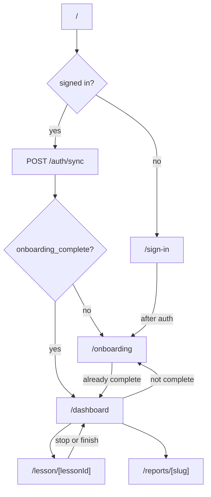
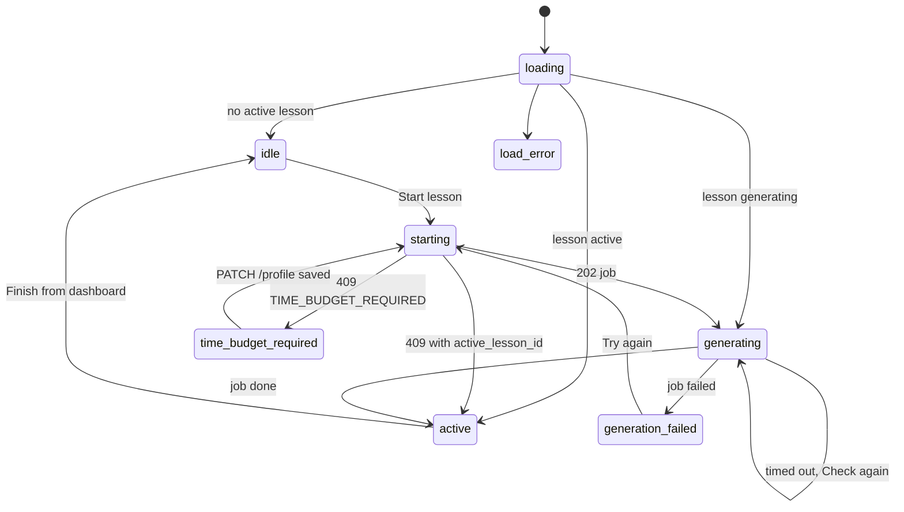

# Frontend

Next.js 16 App Router app in [`apps/frontend`](../../apps/frontend), with React 19, Tailwind CSS 4, and Clerk. It renders the screens and calls the FastAPI backend; all business rules live in the backend.

## Layout

```
apps/frontend/
  proxy.ts                 clerkMiddleware (Next.js 16 name for middleware.ts)
  app/
    layout.tsx             ClerkProvider, fonts, global styles
    page.tsx               root gate: sign-in, onboarding, or dashboard
    sign-in/[[...sign-in]] Clerk <SignIn>
    onboarding/            page (server) + OnboardingChat + PlanSummaryCard
    dashboard/             page (server) + DashboardClient (state machine) and its sections:
                           DeskHero, GeneratingHero, ActiveLessonHero, TimeBudgetPrompt,
                           PaceSummary; hooks use-progress, use-generation-poll;
                           dashboard-state (DashboardState type)
    lesson/[lessonId]/     page (server) + LessonChat + LessonTimeCard
    reports/[slug]/        page (server) + ReportBody, ReportSection, ReportTable
  components/              AppHeader, AccountMenu, ChatComposer, ChatMessageBubble,
                           FinishLessonDialog, PostAuthRedirect, RootAuthGate, ui/Button
  lib/
    api.ts                 apiFetch, apiRequest, apiJson, ApiError, toApiError,
                           isNotFoundError, syncUser
    chat.ts                sessions, messages, JSON post, onboarding accept, types
    use-chat-turn.ts       useChatTurn: shared send / retry / error state for both chats
    lessons.ts             start/active/get/stop/finish, job polling, finish hint
    profile.ts             PATCH /profile (lesson length)
    progress.ts            GET /progress
    reports.ts             GET /reports/{type}, section parsing
    wait-for-token.ts      waits for Clerk to issue a JWT
```

Server components protect routes with `auth.protect()` and do the first fetch. Client components own interaction.

## Routing



`PostAuthRedirect` (on sign-in) and `RootAuthGate` (on `/`) cover the moment when Clerk has finished on the client but the server cookie is not ready yet; they poll `waitForToken` and then navigate.

Report slugs: `progress`, `errors`, `roadmap`, `four-week-plan`. The account menu links to each.

## API access

- `apiFetch(path, token, init)` prefixes the base URL, sets `Authorization: Bearer`, `Content-Type`, and a fresh `X-Request-ID`, and disables the Next fetch cache.
- The base URL is `API_URL` on the server (the Compose service name `http://backend:8000`) and `NEXT_PUBLIC_API_URL` in the browser (`http://localhost:8000`).
- `toApiError` turns a non-2xx response into `ApiError {status, code, message, requestId}`, reading `{detail, code}` when the body is JSON.
- `apiRequest(path, token, init, fallbackMessage)` is `apiFetch` plus `throw toApiError(...)` on a non-2xx status; `apiJson<T>(...)` also returns the parsed body. Every `lib/*.ts` client uses them. Only `startLesson` reads the error body itself (it needs `active_lesson_id`), and `sendChatMessage` maps a dropped connection to `ApiError 503 NETWORK_ERROR`.
- **Not found on id routes.** `isNotFoundError(error)` is true for `404`, and for `422` without a business code: the backend types `lesson_id`, `session_id` and `job_id` path params as UUIDs, so a malformed id is rejected by FastAPI with `422` before the handler runs. The lesson page shows "Not found", the lesson chat drops a cached session id and creates a new session, and dashboard polling stops with "This lesson is no longer available". A `422` with a code (`EMPTY_MESSAGE`, `TIME_BUDGET_REQUIRED`, ...) is a real validation error.

## Onboarding screen

[`OnboardingChat`](../../apps/frontend/app/onboarding/OnboardingChat.tsx) receives the session id and transcript from the server page.

- A turn is one JSON post through `sendChatMessage`, via `useChatTurn` (below). The learner bubble appears immediately. An empty coach bubble shows typing dots until the body arrives, then that bubble is replaced with one stored message. Corrections, tips, and the plan card arrive with it.
- When the response carries `course_roadmap_draft`, the coach prose bubble stays hidden and the latest draft is shown in `PlanSummaryCard` (left panel on desktop, above the chat on narrow screens). The active plan is derived from the transcript: the newest assistant message with a draft; earlier drafts are superseded. The card shows "N min per lesson · M days/week" from `weekly_template`. The card tolerates missing fields because the backend stores the model's roadmap as sent. Dots show until the body arrives, then the card. The card is marked regenerating only while the hidden "I'd like to change my plan." send is in flight. Any other send after a plan only sets the busy state.
- A failed send removes the pending coach bubble and shows the retry line. Retry posts the message again.
- **Change** sends the hidden message "I'd like to change my plan." without showing it as a learner bubble.
- **Accept** posts `{session_id, course_roadmap}` to `/onboarding/accept` and navigates to `/dashboard`. A `422 TIME_BUDGET_REQUIRED` shows "Tell the coach how many minutes each lesson should last, then accept the updated plan."

## Dashboard

[`DashboardClient`](../../apps/frontend/app/dashboard/DashboardClient.tsx) is a small state machine:



- Job polling: `GET /jobs/{id}` every 1.8 s, up to 85 attempts (about 150 s, above the 120 s Gemini timeout). After that the UI shows "taking longer than usual" with **Check again**.
- `DashboardClient` owns the state and handlers; each section is its own component (`DeskHero`, `GeneratingHero` with the elapsed ticker, `ActiveLessonHero`, `TimeBudgetPrompt`), and polling and `/progress` live in `useGenerationPoll` and `useProgress`.
- **Lesson length required.** A profile without `time_budget.minutes_per_session` gets `409 TIME_BUDGET_REQUIRED` from start. `TimeBudgetPrompt` asks "How many minutes per lesson?" (5–180), sends `PATCH /profile` with `{"time_budget": {"minutes_per_session": N}}`, then starts again.
- The active lesson card offers **Resume** (opens the lesson chat) and **Finish** (opens `FinishLessonDialog`). It previews the goal, grammar focus, vocab theme and lesson length; the lesson chat itself shows only the goal. Finishing from the dashboard has no timing, so the dialog just says "Marks it accomplished."
- `PaceSummary` renders `/progress`. If it fails, it shows a small note and the main action still works.
- After a finish in the lesson chat, `writeFinishHint` stores a one-line acknowledgment in `sessionStorage`; the dashboard reads and clears it on mount.

## Lesson chat

[`LessonChat`](../../apps/frontend/app/lesson/[lessonId]/LessonChat.tsx) gets the lesson from the server page.

- It creates or resumes the lesson chat session (the id is cached in `sessionStorage` per lesson) and loads the transcript. If the cached id is not found (404 / 422), it is dropped and a new session is opened once.
- A turn is one JSON post through `sendChatMessage` (via `useChatTurn`). Typing dots show in an empty coach bubble, then one stored message. Corrections, tips and `timing` arrive with that message. A failed send removes the pending bubble and shows the retry line.
- The top bar shows `curriculum.lesson_goal` (or "Lesson N"), **Stop session** and **Finish lesson**.
- `LessonTimeCard` (pinned top right) shows "**8 / 15 min**" and a thin progress bar from `metadata.timing` `{active_minutes, target_minutes}`. The backend measures active minutes, so the card changes once per turn; it is not a ticking timer. On reload it uses the newest assistant message that has `timing` (older messages lack it). Before the first turn it shows 0 of `payload.target_minutes`; with neither, the card is hidden.
- `suggest_finish` from the latest assistant message (also after reload) highlights the finish action and shows "That's today's practice time."
- **Stop** calls `/lessons/{id}/stop` (failures are ignored) and returns to the dashboard.
- **Finish** opens `FinishLessonDialog`: "You practiced about X of Y min. Marks it accomplished." or, when Y − X > 1 (the backend's `finished_early` rule), "You practiced about X of Y min. It still counts; we'll note the ~Z min you missed." (Z = Y − X). The wording is approximate because `timing` is from the last turn while the backend counts up to the click. It posts `{learner_feedback}` (optional, may be `{}`), writes the finish hint, and returns to the dashboard. An early finish still counts as an accomplished plan day.

## Shared chat components

- `useChatTurn(sessionId, initialMessages?)` (in `lib/use-chat-turn.ts`) owns the transcript (`messages`, `setMessages`), `isSending`, `sendError`, `lastFailed`, `send(content, {hidden})` and `retry()`. One turn runs at a time. Onboarding passes the server-loaded transcript and sends its Start / Change-plan triggers with `hidden: true`; the lesson chat fills `messages` after it opens the session.
- `ChatMessageBubble` renders learner and coach messages. While a reply is in flight the empty coach bubble shows typing dots; the stored message replaces it in one step. Coach markdown is rendered with `react-markdown` and `remark-gfm`; links open in a new tab. Corrections and tips from metadata render under the coach bubble.
- `ChatComposer` is the text box with Enter to send and Shift+Enter for a newline. It is disabled while the reply is in flight.

## Reports

[`ReportBody`](../../apps/frontend/app/reports/ReportBody.tsx) loads one report and splits it on `<!-- section:ID -->` markers with the ids in `REPORT_SECTION_IDS`. Each section renders as a card; markdown tables render with `ReportTable`. Missing sections and a missing report show "Fills in after your first lesson". Markers are stripped before display.
