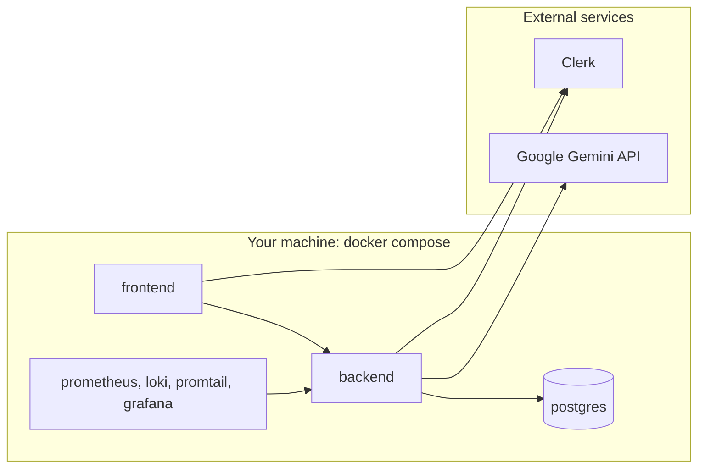

# Hosting

Lingua Coach runs from the Docker Compose stack in [deployment.md](./deployment.md). The repository contains no cloud hosting configuration: no Vercel project, Railway service, Terraform, or managed database setup.

## What runs where

| Component | Runs in | Owner |
|-----------|---------|-------|
| Next.js frontend | Compose `frontend` (`next dev`) | This repo |
| FastAPI backend | Compose `backend` (`uvicorn --reload`) | This repo |
| PostgreSQL | Compose `postgres`, volume `lingua_pg_data` | This repo |
| Monitoring | Compose profile `monitoring` | This repo |
| Authentication | Clerk (Development instance by default) | External, configured with Clerk keys |
| LLM | Google Gemini API | External, configured with `GEMINI_API_KEY` |

## External accounts needed

- **Clerk**: an application with email sign-in. Copy the publishable key and secret key into both env files. With a Development instance, leaving `CLERK_JWT_ISSUER` empty is enough.
- **Google AI Studio**: a Gemini API key. Set the global backend limits (`LLM_RPM_LIMIT`, `LLM_INPUT_TPM_LIMIT`, `LLM_RPD_LIMIT`) to match the key's quota.

## Moving off Compose

The containers are dev-oriented: both mount the source and run with reload. A hosted setup would need:

- a production frontend build (`npm run build` and `npm run start`);
- the backend image without `--reload` (its default `CMD` already serves on `${PORT:-8000}`);
- a managed Postgres reachable through `DATABASE_URL`, with `alembic upgrade head` run on deploy;
- `CORS_ORIGINS`, `NEXT_PUBLIC_API_URL`, and `API_URL` set to the public URLs;
- `APP_ENV=production` and a Clerk Production instance with `CLERK_JWT_ISSUER` set to its issuer (the app refuses to start outside `local` without it);
- `LANGSMITH_TRACING` unset or `false` (enforced in production);
- Prometheus able to reach `/metrics`, or `METRICS_ENABLED=false`.
